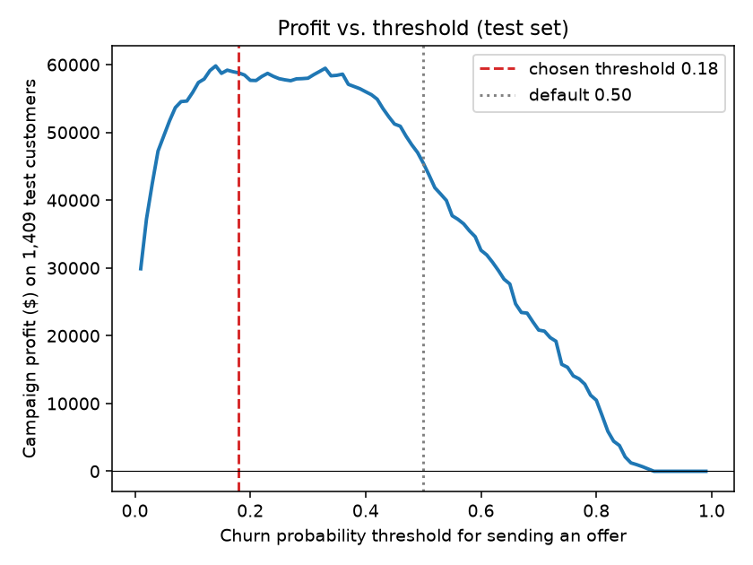
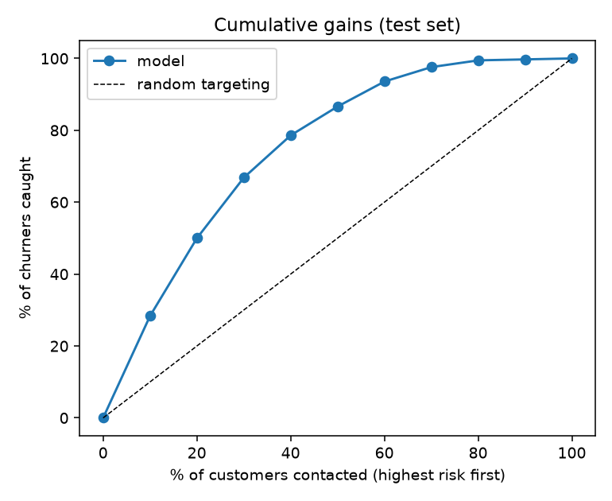
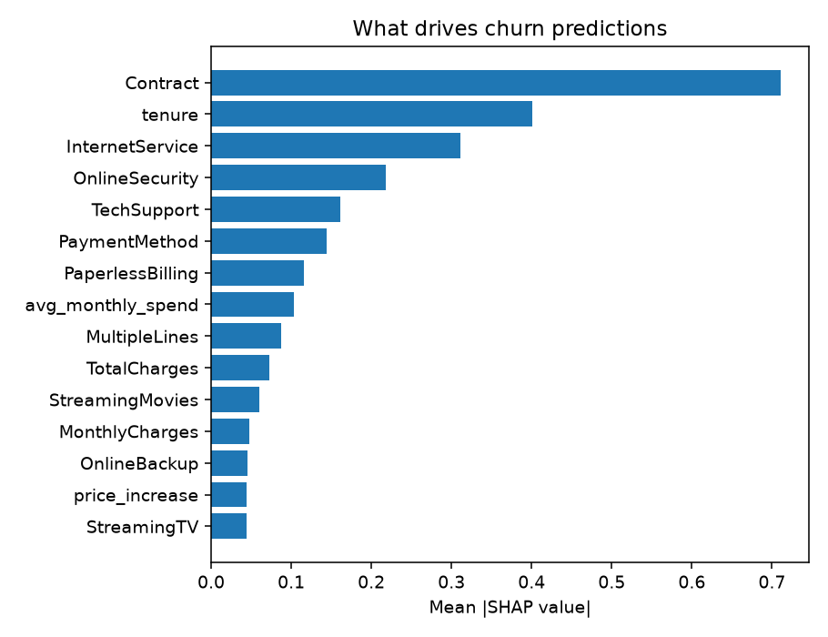
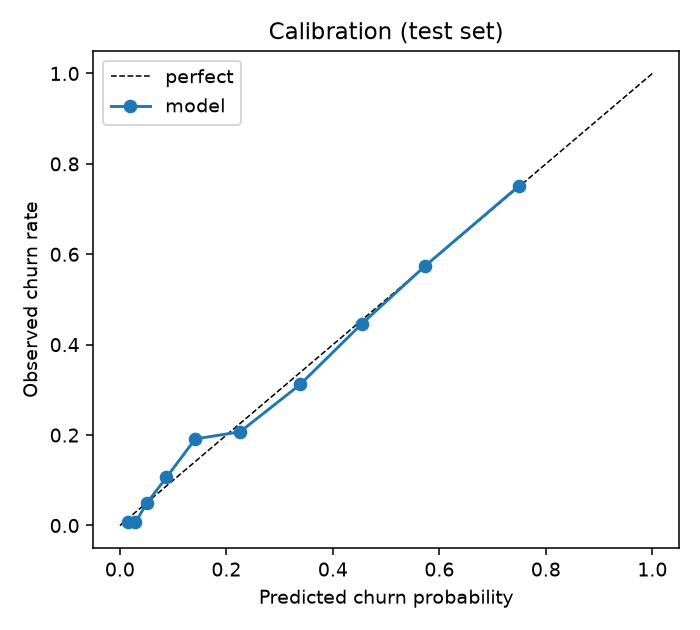
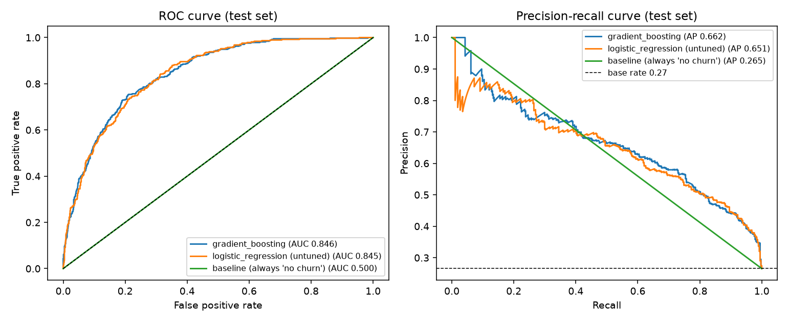

# Customer Churn Prediction & Retention Optimizer


Predicts which telecom customers are about to leave, explains **why** for each one, and decides
**who is worth sending a retention offer to** by maximizing expected campaign profit rather than
accuracy. Ships as a tested Python package, a FastAPI service and an interactive Streamlit dashboard.

> Dataset: [IBM Telco Customer Churn](https://github.com/IBM/telco-customer-churn-on-icp4d), 7,043 customers, 26.5% churn.

## Results (held-out test set, 1,409 customers)

| | |
|---|---|
| **ROC-AUC** | **0.846** (majority-class baseline: 0.50) |
| **PR-AUC** | **0.662** (random: 0.27) |
| **Riskiest 20% of customers** | contain **50%** of all churners (top-decile lift 2.8×) |
| **Campaign profit, per 1,000 customers** | **$43.8K** with value-based targeting vs **$32.3K** at the default 0.5 threshold (**+36%**) and $21.1K for "offer everyone" |

Best model: Optuna-tuned histogram gradient boosting (CV ROC-AUC 0.849), narrowly ahead of tuned
random forest (0.848) and logistic regression (0.847). The gap between model families is tiny; the
large gain comes from **deciding who to target** with the probabilities, not from a fancier classifier.

| Targeting policy (test set) | % contacted | Churners reached | Profit / 1,000 customers |
|---|---:|---:|---:|
| No campaign | 0% | 0 | $0 |
| Offer everyone | 100% | 374 | $21,123 |
| Model, default 0.5 threshold | 21% | 194 | $32,266 |
| Model, profit-tuned threshold (0.18) | 50% | 323 | $41,720 |
| **Model, per-customer expected value (deployed)** | **44%** | **297** | **$43,823** |

Biggest churn drivers (mean |SHAP|): contract type, tenure, internet service (fiber), no online security, no tech support, payment method.

*Profit figures depend on the campaign assumptions in [`config.yaml`](config.yaml) ($60 offer, 35% of targeted churners retained, 12 months of revenue saved).

## Why not just accuracy?

Only 26.5% of customers churn, so a "model" that always predicts *no churn* is **73.5% accurate** while
catching zero churners. The first version of this project reported ~78% accuracy, which is barely
better than that. This version is evaluated on what matters:

- **Ranking quality:** ROC-AUC, PR-AUC and a cumulative gains / lift chart ("call the riskiest 20% and you reach X% of churners").
- **Calibration:** Brier score and a calibration plot. Probabilities need to mean what they say, because they feed a dollar calculation.
- **Money:** profit of the retention campaign each targeting rule produces.

## How it works

```
raw CSV → clean → FeatureEngineer → ColumnTransformer(scale + one-hot) → model
                                       ↑ all inside one sklearn Pipeline (no leakage, same code in prod)
```

1. **Cleaning.** The 11 blank `TotalCharges` rows are all brand-new customers (tenure 0), so they're filled with $0 instead of being dropped.
2. **Feature engineering.** Number of services subscribed, lifetime average bill, recent price increase (current bill minus historical average), auto-pay flag, tenure bands.
3. **Model selection.** Logistic regression, random forest and histogram gradient boosting are compared with stratified 5-fold CV against a majority-class baseline, then each is tuned with **Optuna** (TPE). The best cross-validated ROC-AUC wins.
4. **Imbalance handled at decision time, not by reweighting.** Class weights would distort the probabilities. Instead the model stays calibrated and the *decision rule* accounts for costs.
5. **Profit-optimal targeting.** For each customer:

   ```
   expected value of an offer = P(churn) × success_rate × (MonthlyCharges × horizon) − offer_cost
   ```

   Two policies are chosen on **out-of-fold training predictions only** (never the test set): one global profit-maximizing threshold, and a per-customer expected-value rule that also accounts for how valuable each customer is. Whichever earns more is deployed. The assumptions live in [`config.yaml`](config.yaml).
6. **Explainability.** SHAP values, with one-hot columns rolled back up to the original features, give global drivers and the top reasons for every individual prediction.

<p>
  
  
</p>
<p>
  
  
</p>



Full tables: [`model_comparison.csv`](reports/model_comparison.csv) · [`policy_comparison.csv`](reports/policy_comparison.csv) · [`gains.csv`](reports/gains.csv) · [`metrics.json`](reports/metrics.json)

## Project layout

```
src/churn/
  data.py        load + clean
  features.py    feature engineering, preprocessing, one-hot → feature mapping
  models.py      candidate models + Optuna search spaces
  business.py    retention economics, profit curves, targeting policies
  evaluate.py    metrics, gains table, figures
  explain.py     SHAP explanations grouped by original feature
  train.py       end-to-end training CLI
  predict.py     load the model bundle and score customers
api/main.py      FastAPI service (validated input schema, /predict, /predict/batch, /health)
app/             Streamlit dashboard
tests/           pytest suite (runs offline on synthetic data)
```

## Quickstart

```bash
python -m venv .venv && source .venv/bin/activate
make install          # pip install -e ".[api,app,dev]"
make train            # downloads data, compares/tunes models, writes models/ and reports/
make test
```

**Dashboard:** `make app`. Score a customer and see their SHAP reasons, try "what if they switch to a one-year contract?", upload a CSV to get a prioritized call list, and browse the model card.

**API:** `make api`, then open http://localhost:8000/docs.

```bash
curl -X POST localhost:8000/predict -H "Content-Type: application/json" -d '{
  "gender": "Female", "SeniorCitizen": 0, "Partner": "No", "Dependents": "No", "tenure": 2,
  "PhoneService": "Yes", "MultipleLines": "No", "InternetService": "Fiber optic",
  "OnlineSecurity": "No", "OnlineBackup": "No", "DeviceProtection": "No", "TechSupport": "No",
  "StreamingTV": "Yes", "StreamingMovies": "No", "Contract": "Month-to-month",
  "PaperlessBilling": "Yes", "PaymentMethod": "Electronic check",
  "MonthlyCharges": 85.5, "TotalCharges": 171.0}'
```

```json
{
  "churn_probability": 0.7416,
  "risk_tier": "high",
  "send_offer": true,
  "expected_offer_value": 206.3,
  "top_reasons": [
    {"feature": "Contract", "value": "Month-to-month", "impact": 0.8072, "direction": "increases risk"},
    {"feature": "tenure", "value": 2, "impact": 0.6037, "direction": "increases risk"},
    {"feature": "InternetService", "value": "Fiber optic", "impact": 0.3233, "direction": "increases risk"},
    ...
  ]
}
```

**Docker:** `make docker` builds and runs the API image (train first).

## Limitations and next steps

- The campaign economics (offer cost, success rate, horizon) are assumptions. In a real deployment they'd come from an A/B-tested retention campaign, ideally with an **uplift model** that predicts who the offer actually *changes*, not just who is at risk.
- The data is a single snapshot. **Survival analysis** (e.g. a Cox model) would predict *when* a customer leaves.
- No drift monitoring yet. Adding scheduled retraining and population-stability checks would be the next production step.
